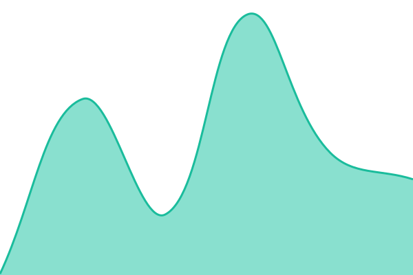

# [📈 Live Status](https://Antnioo.github.io/dataarcus-status): <!--live status--> **🟩 All systems operational**

This repository contains the open-source uptime monitor and status page for [DataArcus](https://Antnioo.github.io/dataarcus-status), powered by [Upptime](https://github.com/upptime/upptime).

With [Upptime](https://upptime.js.org), you can get your own unlimited and free uptime monitor and status page, powered entirely by a GitHub repository. We use [Issues](https://github.com/Antnioo/dataarcus-status/issues) as incident reports, [Actions](https://github.com/Antnioo/dataarcus-status/actions) as uptime monitors, and [Pages](https://Antnioo.github.io/dataarcus-status) for the status page.

<!--start: status pages-->
<!-- This summary is generated by Upptime (https://github.com/upptime/upptime) -->
<!-- Do not edit this manually, your changes will be overwritten -->
<!-- prettier-ignore -->
| URL | Status | History | Response Time | Uptime |
| --- | ------ | ------- | ------------- | ------ |
|  [Home (English)](https://dataarcus.com/) | 🟩 Up | [home-english.yml](https://github.com/Antnioo/dataarcus-status/commits/HEAD/history/home-english.yml) | 

 167ms
     
 | 

<a href="https://Antnioo.github.io/dataarcus-status/history/home-english">100.00%</a>
    

|  [Home (Arabic)](https://dataarcus.com/ar/) | 🟩 Up | [home-arabic.yml](https://github.com/Antnioo/dataarcus-status/commits/HEAD/history/home-arabic.yml) | 

 113ms
     
 | 

<a href="https://Antnioo.github.io/dataarcus-status/history/home-arabic">100.00%</a>
    

|  [DataArcus for Power BI (download page)](https://dataarcus.com/power-bi-mcp/) | 🟩 Up | [data-arcus-for-power-bi-download-page.yml](https://github.com/Antnioo/dataarcus-status/commits/HEAD/history/data-arcus-for-power-bi-download-page.yml) | 

 100ms
     
 | 

<a href="https://Antnioo.github.io/dataarcus-status/history/data-arcus-for-power-bi-download-page">100.00%</a>
    

|  [Power BI Theme Generator](https://dataarcus.com/tools/power-bi-theme-generator.html) | 🟩 Up | [power-bi-theme-generator.yml](https://github.com/Antnioo/dataarcus-status/commits/HEAD/history/power-bi-theme-generator.yml) | 

 151ms
     
 | 

<a href="https://Antnioo.github.io/dataarcus-status/history/power-bi-theme-generator">100.00%</a>
    

|  [DAX Calendar Table Generator](https://dataarcus.com/tools/dax-calendar-table-generator.html) | 🟩 Up | [dax-calendar-table-generator.yml](https://github.com/Antnioo/dataarcus-status/commits/HEAD/history/dax-calendar-table-generator.yml) | 

 155ms
     
 | 

<a href="https://Antnioo.github.io/dataarcus-status/history/dax-calendar-table-generator">100.00%</a>
    

|  [Power BI Model Health Check](https://dataarcus.com/tools/power-bi-model-health-check.html) | 🟩 Up | [power-bi-model-health-check.yml](https://github.com/Antnioo/dataarcus-status/commits/HEAD/history/power-bi-model-health-check.yml) | 

 123ms
     
 | 

<a href="https://Antnioo.github.io/dataarcus-status/history/power-bi-model-health-check">100.00%</a>
    

<!--end: status pages-->

[**Visit our status website →**](https://Antnioo.github.io/dataarcus-status)

## 📄 License

- Powered by: [Upptime](https://github.com/upptime/upptime)
- Code: [MIT](./LICENSE) © [Anand Chowdhary](https://anandchowdhary.com)
- Data in the `./history` directory: [Open Database License](https://opendatacommons.org/licenses/odbl/1-0/)
